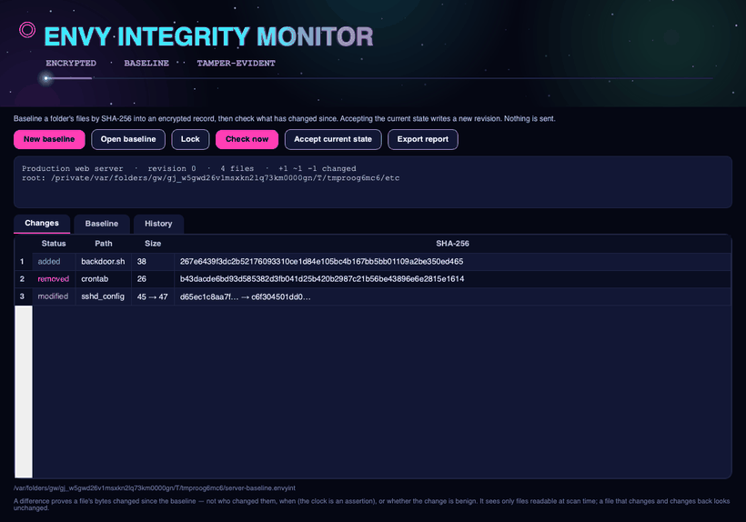
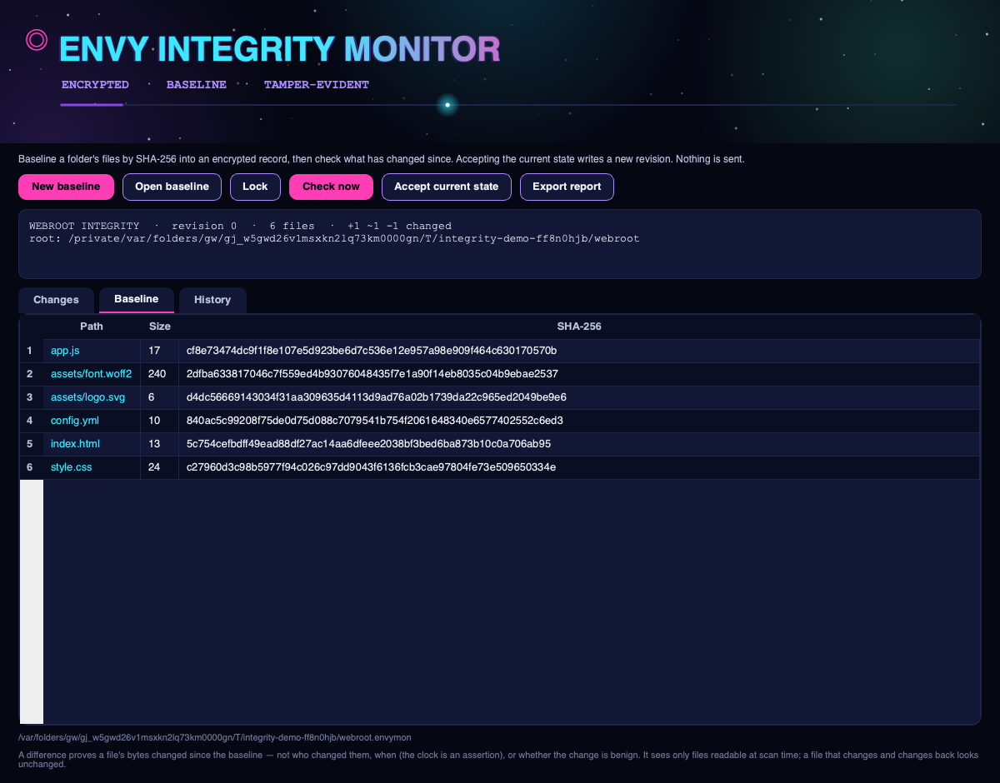

<p align="center">
  
</p>

<p align="center"><b>Baseline a folder's files by SHA-256 into an encrypted record, then see exactly what has been added, removed or modified since — in a real native app window.</b><br />
AES-256-GCM encrypted baselines, a hash-chained change journal, revision-preserving accepts, and plaintext export. From ENVY BLACK VEIL, as a standalone app.</p>

<p align="center">
  <a href="https://github.com/xzchick/envy-integrity-monitor/actions/workflows/tests.yml"></a>
</p>
<p align="center">
  
  
  <br />
  
  
  
  
</p>

<p align="center">
  <a href="#install"><b>Install</b></a> ·
  <a href="#works-on">Compatibility</a> ·
  <a href="#using-it">Using it</a> ·
  <a href="#honest-by-design">What it isn't</a> ·
  <a href="#build--test">Build</a>
</p>

<p align="center">
  
</p>

<p align="center"><sub>A real native window — not a browser view. The title pulses, the stars twinkle, and a light travels the accent bar.</sub></p>

<a name="features"></a>




Point it at a folder and it records the **SHA-256, size and relative path** of every file into an **AES-256-GCM** encrypted baseline — the same envelope [ENVY Vault](https://github.com/xzchick/envy-vault) uses. A **check** re-scans the folder and reports what has been **added, removed or modified** since, down to the old → new hash of each changed file. When a new state is intended, **accept** it: the change summary is appended to a **SHA-256 hash-chained journal** and a new baseline revision is written — the previous one is never overwritten.

<p align="center">
  
</p>

The **Baseline** tab shows the known-good state the checks compare against, and **History** shows every accepted change. Everything is local, and a plaintext HTML or JSON report can be exported whenever you choose.

<a name="works-on"></a>


<p align="center">
  
  
  
</p>



### Requirements

| | 🍎 macOS | 🪟 Windows | 🐧 Linux |
|---|---|---|---|
| **OS version** | macOS 11 Big Sur or newer | Windows 10 or 11 (64-bit) | A current x86_64 or arm64 desktop |
| **Standalone bundle** | Nothing else to install | Nothing else to install | Standard desktop libraries (X11 or Wayland) |
| **From pip** | Python 3.10+ | Python 3.10+ | Python 3.10+ and a desktop session |
| **Dependencies** | `cryptography` + Qt (bundled) | `cryptography` + Qt (bundled) | `cryptography` + Qt (bundled) |
| **Network** | None, ever | None, ever | None, ever |

<a name="install"></a>


A **standalone bundle** that needs no Python, or **pip** if you already have Python 3.10+.

### Standalone bundle (no Python)

Download a bundle from the [latest release](https://github.com/xzchick/envy-integrity-monitor/releases/latest):

| File | System | Run it |
|---|---|---|
| `envy-integrity-monitor-v0.1.0-macos-arm64.tar.gz` | macOS (Apple Silicon) | `tar -xzf` it, then open `envy-integrity-monitor` |
| `envy-integrity-monitor-v0.1.0-windows-x86_64.zip` | Windows (64-bit) | Unzip, then run `envy-integrity-monitor.exe` |
| `envy-integrity-monitor-v0.1.0-linux-x86_64.tar.gz` | Linux (64-bit) | `tar -xzf` it, then run `./envy-integrity-monitor` |
| `envy_integrity_monitor-0.1.0-py3-none-any.whl` | Any OS with Python 3.10+ | `pip install` the wheel |
| `SHA256SUMS.txt` | — | Verify your download first |

Running `envy-integrity-monitor` with no arguments opens the window.

### Homebrew (macOS, Apple Silicon)

```sh
brew install --cask xzchick/envy/envy-integrity-monitor
```

These builds aren't notarized, so if macOS blocks it on first run, add `--no-quarantine` to that command. Intel Macs, Linux and Windows: use the standalone bundle above.

### From pip (Python 3.10+)

```sh
git clone https://github.com/xzchick/envy-integrity-monitor.git
cd envy-integrity-monitor
python3 -m venv .venv
. .venv/bin/activate          # Windows: .venv\Scripts\activate
pip install .
envy-integrity-monitor         # opens the window
```

<a name="using-it"></a>


**In the window**

- **New baseline** → choose a folder, name the monitor, set a passphrase (at least 12 characters). It hashes every file into an encrypted baseline.
- **Check now** → re-scans and fills the **Changes** tab with added / removed / modified files, coloured by status.
- **Accept current state** → records the change summary in the journal and writes a new baseline revision.
- **Export report** → writes a plaintext HTML or JSON change report.

**In the terminal**

```sh
envy-integrity-monitor baseline web.envymon ./webroot --title "Webroot"
envy-integrity-monitor check web.envymon                 # what changed? (exit 1 if anything did)
envy-integrity-monitor accept web.envymon web.r1.envymon # trust the current state -> new revision
envy-integrity-monitor export web.envymon report.html --format html
```

`check` exits non-zero when anything changed, so it drops straight into a script or a pre-commit hook. Every write is a new file; the baseline is never overwritten.

<a name="honest-by-design"></a>


The baseline and journal are sealed with **AES-256-GCM** and a key derived from your passphrase with **scrypt**, and a single changed byte changes a file's SHA-256. What the Monitor does **not** do is just as important:

- **A difference proves change, not cause.** A modified hash means the bytes changed since the baseline. It says nothing about *who* changed them, *when*, or whether the change is benign.
- **Times are assertions.** Scan and accept times come from your machine's clock; the hash chain does not establish a trusted time.
- **It sees only what it can read at scan time.** A file changed and changed back looks unchanged, and files unreadable during the scan are skipped. Symlinks are not followed.
- **Accepting trusts the disk.** Accepting a state records whatever is on disk at that moment as the new known-good — so only accept when you mean to.
- **Nothing is sent.** No network, no accounts. Every result is a new local file.

> [!IMPORTANT]
> Keep your passphrase safe. There is no recovery: without it, an encrypted baseline cannot be opened.

<a name="build--test"></a>


```sh
python -m unittest discover -s tests -v          # unit tests (no display needed)
pip install pyinstaller build
python scripts/build_release_bundle.py           # standalone bundle + wheel + sdist + checksums
python scripts/smoke_test_release.py             # launch the built bundle and check it runs
```

CI runs all of this on Ubuntu, Windows and macOS for every push. Regenerate the README artwork with `python scripts/render_readme_art.py`.

## Security

Security policy and private vulnerability reporting: **[SECURITY.md](SECURITY.md)**. What ENVY Integrity Monitor does and does not protect against: **[THREAT_MODEL.md](THREAT_MODEL.md)**.

## The ENVY BLACK VEIL suite

ENVY Integrity Monitor is one of eleven standalone apps from **ENVY BLACK VEIL** — small native desktop tools that are offline by design: no network, no accounts, no telemetry, everything encrypted at rest.

| App | What it does |
|---|---|
| [ENVY Vault](https://github.com/xzchick/envy-vault) | Local AES-256 file encryption |
| [ENVY Veil](https://github.com/xzchick/envy-veil) | Steganography — hide an encrypted file in an image or audio carrier |
| [ENVY Hypothesis](https://github.com/xzchick/envy-hypothesis) | Analysis of Competing Hypotheses |
| [ENVY Oracle](https://github.com/xzchick/envy-oracle) | Forecast tracking with calibration scoring |
| [ENVY SkyWatch](https://github.com/xzchick/envy-skywatch) | Watchlists with offline content scanning |
| [ENVY Casebook](https://github.com/xzchick/envy-casebook) | Encrypted, revision-preserving case notes |
| [ENVY Cryptography Workbench](https://github.com/xzchick/envy-crypto-workbench) | Classical ciphers, encoding and text analysis |
| [ENVY Orbit](https://github.com/xzchick/envy-orbit) | Recurring-cadence tracking |
| [ENVY Ops Desk](https://github.com/xzchick/envy-ops-desk) | Operations plans with authenticated handoffs |
| [ENVY Evidence Vault](https://github.com/xzchick/envy-evidence-vault) | File intake with a hash-verified custody journal |
| **ENVY Integrity Monitor** — *you are here* | File-integrity baselines and change detection |

<p align="center"><sub>MIT licensed. Part of ENVY BLACK VEIL, packaged as a standalone app. Offline; no telemetry, no network, no accounts.</sub></p>
